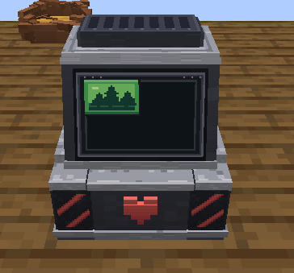
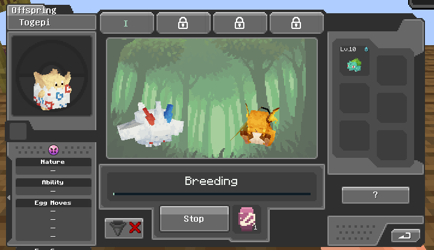
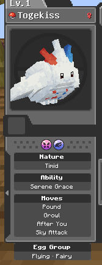
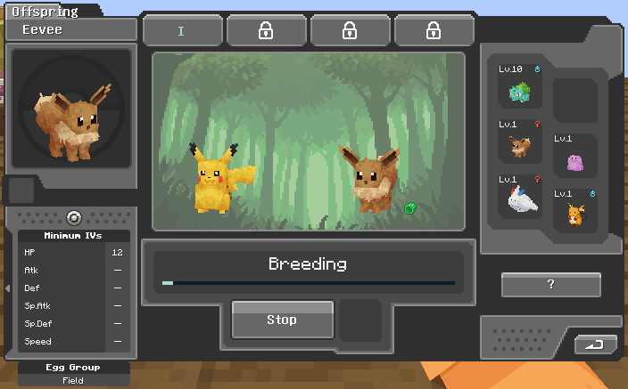
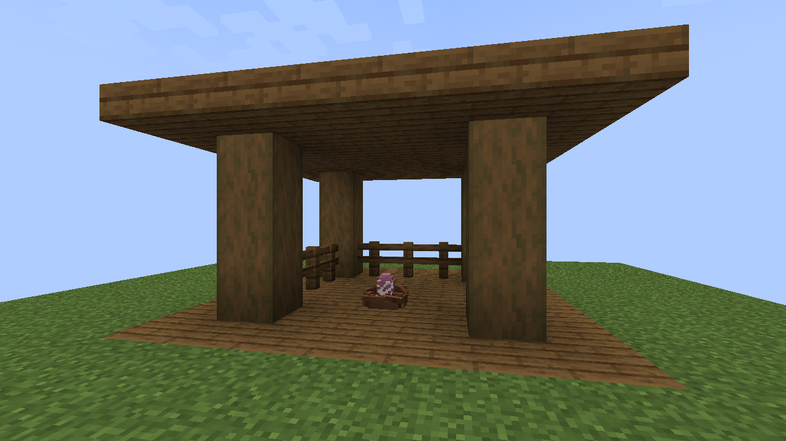
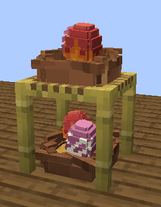
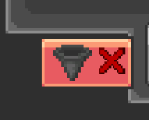
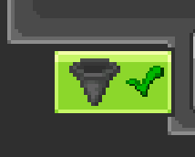

# Guía de Cobblemon Daycare

[English](Guide.md)

## Consigue una terminal y un nido

La Terminal de Crianza sirve para elegir padres y recoger huevos. Se fabrica con cuatro lingotes de hierro, dos polvos de redstone, un lingote de cobre, una piedra lisa y un monitor de Cobblemon. También puedes encontrar terminales en algunos Centros Pokémon. Para fabricar un Nido de Incubación necesitas siete palos y una paca de heno.

## Tu primera cría

1. Abre la terminal y pasa dos Pokémon compatibles de tu equipo al patio. Normalmente necesitas un macho y una hembra con un grupo huevo en común. La madre suele determinar la especie de la cría.
2. Pulsa **Iniciar**. El panel muestra la cría esperada y los movimientos huevo que puede heredar. Haz clic en la casilla del huevo para recogerlo cuando aparezca.
3. Pon el huevo en un nido. Haz clic derecho en el huevo para consultar el tiempo restante o recoger la cría cuando esté lista.

## Grupos huevo y Ditto

Selecciona un Pokémon o pasa el cursor sobre él para ver sus grupos huevo en el panel izquierdo. Busca al menos un grupo en común. Ditto puede criar con un Pokémon apto sin importar su sexo ni su grupo huevo. La cría será de la línea evolutiva del otro Pokémon. Dos Ditto no pueden criar entre sí.

*EJEMPLO: Togekiss pertenece a los grupos huevo Volador y Hada.*

## Atributos y herencia

Al nacer, cada atributo recibe un IV de 0 a 31. Cuanto más alto sea el IV, mayor será el atributo. El IV mínimo es el menor valor posible para la cría.

**EJEMPLO:** Con un IV mínimo de 23 en PS, la cría tendrá entre 23 y 31 en ese atributo.

- **Objetos recios.** Hay seis, uno por atributo. El IV del progenitor que lleva el objeto recio es el mínimo para ese atributo. Si ambos llevan el mismo objeto, se usa el IV más alto. Con objetos distintos, se aplican los dos mínimos. La flecha del panel izquierdo muestra los **IVs mínimos** de la cría prevista.

  **EJEMPLO:** Una Eevee con 12 IV en PS lleva la Pesa recia. Sus huevos pueden salir con 12 a 31 en PS. Si uno sale con 24, el próximo huevo de esa misma pareja sigue teniendo un mínimo de 12. Para subirlo a 24, incuba la cría, úsala como progenitora y equípale la Pesa recia.

  

  El mínimo pertenece a la pareja actual y depende de sus objetos. No se guarda por jugador ni pasa a otra pareja. Cambiar de pareja o quitar el objeto solo afecta a huevos futuros.

- **Lazo Destino.** Aumenta de tres a cinco la cantidad de atributos de los que se pueden heredar IV de los padres. No garantiza IV perfectos.
- **Piedra Eterna.** Si solo uno de los padres la lleva, la cría hereda su naturaleza. Si ambos la llevan y tienen naturalezas distintas, puede heredar cualquiera de las dos.
- **Movimientos huevo.** La cría puede heredar movimientos compatibles que conozcan los padres. La terminal muestra hasta cuatro.
- **Habilidad y Poké Ball.** Pueden heredarse, pero el resultado depende de los padres. La terminal no garantiza una habilidad concreta.

## Patios y progreso

El primer patio está desbloqueado. La terminal tiene cuatro pestañas y cada patio desbloqueado puede criar con su propia pareja. Selecciona una pestaña bloqueada para ver el precio. Los servidores pueden ajustar estos precios. El corazón de la terminal indica crianza activa y el signo de exclamación avisa de que hay que recoger huevos.

Los patios 2, 3 y 4 cuestan **64, 128 y 192 monedas reliquia** por defecto. No necesitas un mod de economía adicional.

## Nidos de Incubación

Un nido admite hasta cuatro huevos. La incubación avanza aunque no estés conectado. Los huevos con IV más altos suelen tardar más. Coloca el nido sobre un bloque de apoyo. Puedes apilar nidos usando andamios.

Haz clic derecho en un huevo para consultar los bonos de incubación.

| Bono | Condición | Progreso adicional |
| --- | --- | ---: |
| Refugio | El nido tiene techo y protección en al menos tres lados | 15 % |
| Luz | La luz de bloque sobre el nido es de al menos 10 | 15 % |
| Cuidador | Hay un Pokémon apto a 16 bloques o menos | 30 % |

Togepi, Exeggcute, Chansey, Blissey, Happiny, Vullaby, Togetic, Kangaskhan, Maushold y los Pokémon con Cuerpo Llama pueden cuidar el nido. Los bonos se acumulan. El reloj base sigue avanzando sin ti, pero el tiempo que el nido pase descargado no recibe bonos retroactivos.

**EJEMPLO DE REFUGIO:** Construye un granero pequeño con techo de bloques completos y vallas a ambos lados y al fondo. Puedes dejar el frente abierto. Un techo solo no cuenta. Haz clic derecho en un huevo para comprobar el bono.

## Automatización con tolvas

1. Coloca tu propia terminal encima de una tolva.
2. Abre la terminal, selecciona un patio desbloqueado y activa su botón de tolva. La exportación está desactivada por defecto. Solo quien colocó la terminal puede configurarla.
3. Conduce los huevos a un almacén o a un Nido de Incubación. Si el nido ya tiene huevos, solo acepta huevos del mismo propietario. Para recoger la cría, sigue haciendo clic derecho en el huevo cuando esté listo.

Cada patio exporta por una sola terminal a la vez. Puedes criar en una terminal de aldea, pero no configurar su exportación por tolva.

| Exportación desactivada | Exportación activada |
| --- | --- |
|  |  |
