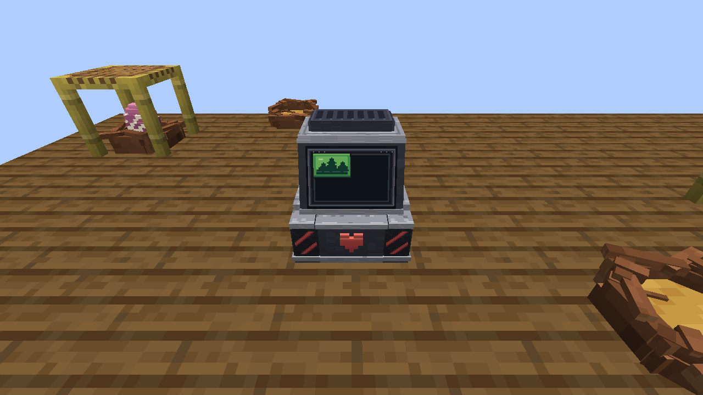
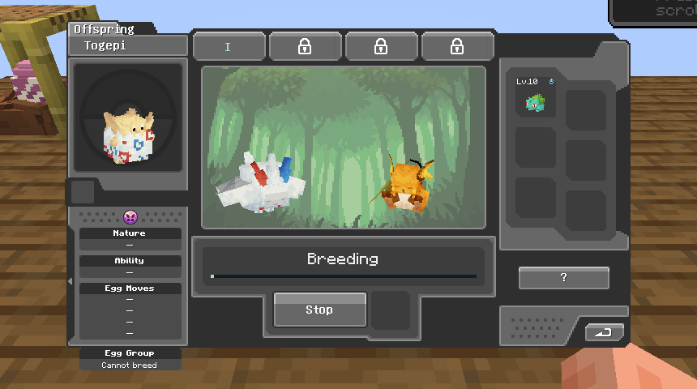
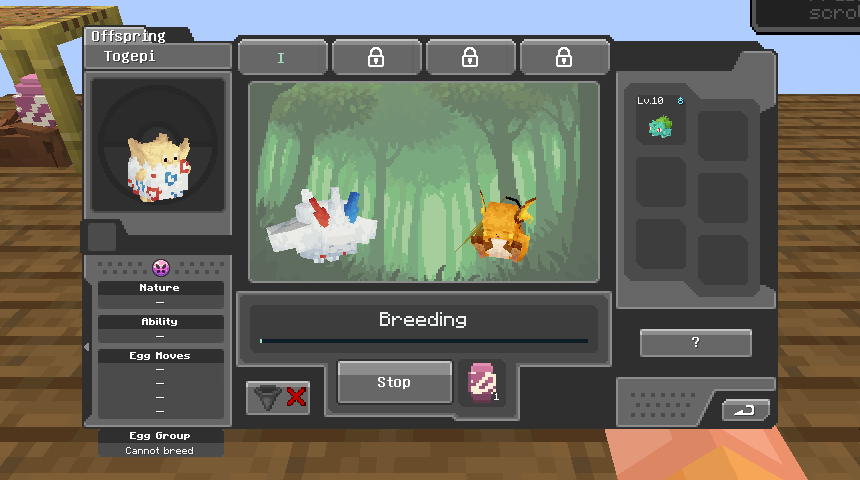
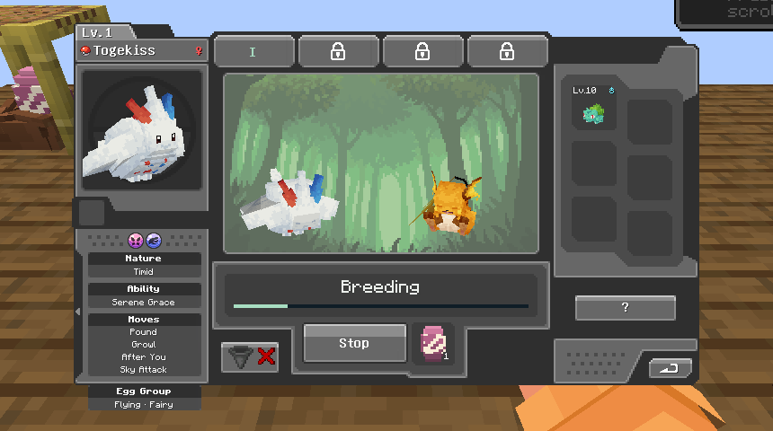
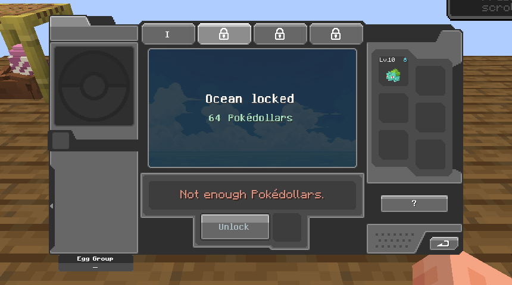
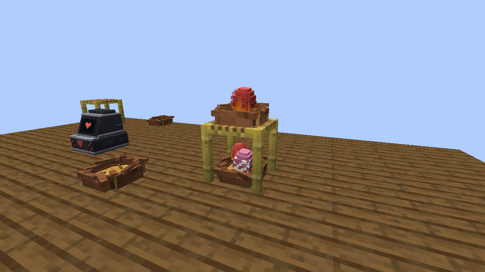
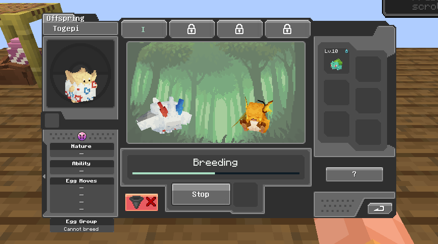

# CobbleNursery Player Guide

[Español](Guia.md)

## Find or craft a nursery

The Nursery Terminal is where you assign parents and collect eggs. Craft one with four iron ingots, two redstone dust, one copper ingot, one smooth stone and a Cobblemon Monitor. You may also find terminals in some Cobblemon Pokémon Centers. Craft an Incubation Nest with seven sticks and a hay bale.

## Your first hatchling

1. Open the Nursery Terminal and move two compatible Pokémon from your party into the habitat. Usually, you need a male and a female that share an Egg Group. The mother usually determines the offspring’s species.
2. Select **Start**. The panel shows the expected offspring and any eligible Egg Moves. Click the egg slot to collect eggs as they appear.
3. Place an egg in an Incubation Nest. Right-click the egg to check its time remaining or collect the hatchling when it’s ready.

## Egg Groups and Ditto

Select or hover over a Pokémon in the terminal to see its Egg Group or Groups in the left panel. Look for at least one shared group when choosing parents. Ditto can breed with an eligible Pokémon regardless of sex or Egg Group. The offspring comes from the other Pokémon’s evolutionary line. Two Ditto cannot breed with each other.

## Stats and inheritance

An individual value (IV) is a number from 0 to 31 that a Pokémon receives at birth for each stat. Higher IVs improve their corresponding stats. A minimum IV is the lowest value the offspring can get for that stat.

**Example:** If the minimum HP IV is 23, the offspring’s HP IV will be between 23 and 31.

- **Power Items:** There are six, one per stat. Give a parent the matching Power Item to set the minimum for that stat. If you hatch a Pokémon with a higher IV, breed it with the corresponding Power Item to raise the minimum. Saved minimums apply to future offspring even without the item and across species.
- **Destiny Knot:** Increases the number of stats eligible for parental IV inheritance from three to five. It does not make those IVs perfect.
- **Everstone:** If just one parent holds an Everstone, the offspring inherits that parent’s nature. When both hold one and their natures differ, either nature can be inherited.
- **Egg Moves:** The offspring can inherit compatible Egg Moves known by its parents. The terminal can display up to four.
- **Ability and Poké Ball:** These can be inherited, but the exact outcome depends on the parents. The terminal does not guarantee a particular ability.

## Habitats and progress

The first habitat is unlocked by default. The terminal has four habitat tabs, and each unlocked habitat can run its own pair. Select a locked tab to see its price. Servers can configure those prices. The terminal’s heart indicates active breeding; the exclamation mark indicates that the egg tray needs attention.

## Incubation Nests

A nest holds up to four eggs. Incubation advances while you are offline, and eggs with higher IVs generally take longer. Put the nest on a supporting block. Scaffolding lets you stack nests vertically.

Right-click an egg to see the active incubation bonuses:

| Bonus | Condition | Extra progress |
| --- | --- | ---: |
| Shelter | Nest is in an enclosed room | 15% |
| Light | Block light above the nest is at least 10 | 15% |
| Caregiver | An eligible Pokémon is within 16 blocks | 30% |

Caregivers include Togepi, Exeggcute, Chansey, Blissey, Happiny, Vullaby, Togetic, Kangaskhan, Maushold, and Pokémon with Flame Body. These bonuses can stack. The base timer still runs offline, but time spent unloaded does not receive retroactive bonus progress.

## Hopper automation

1. Place your own Nursery Terminal above a hopper.
2. Open the terminal, select an unlocked habitat, and turn on its hopper toggle. Export starts disabled. Only the person who placed the terminal can configure its export.
3. Route the hopper into storage or into an Incubation Nest. An Incubation Nest can accept matching-owner eggs when it already has eggs inside. To hatch an egg, still interact with it yourself.

Each habitat exports through at most one terminal at a time. A village terminal can still be used for breeding, but it cannot be configured for hopper export.

